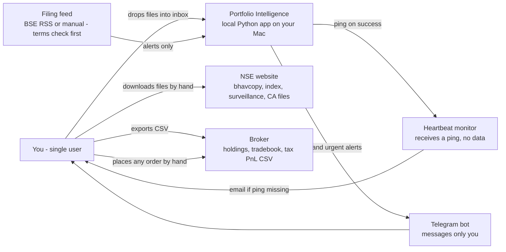
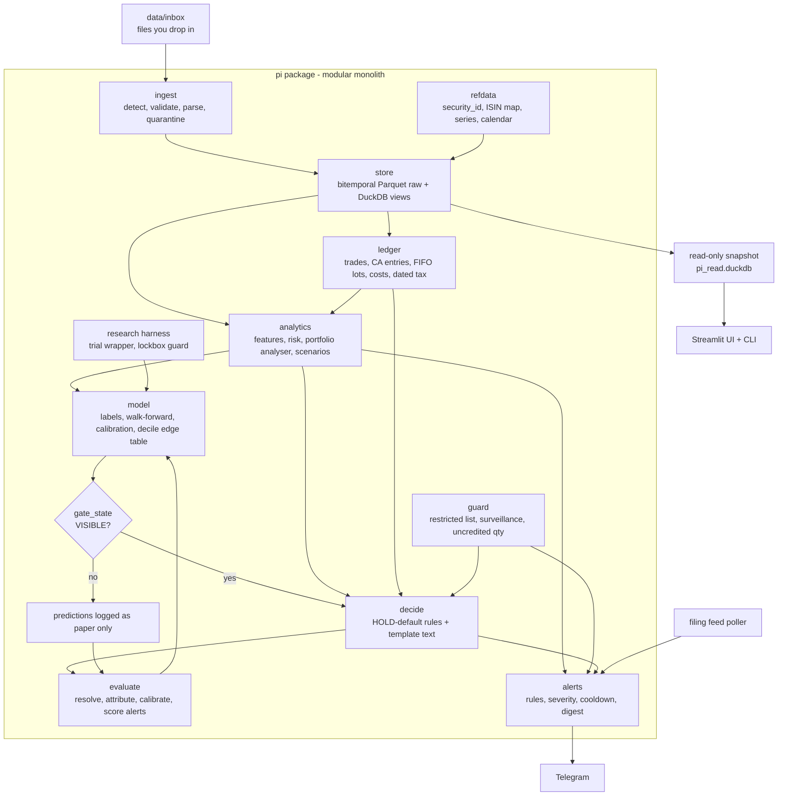
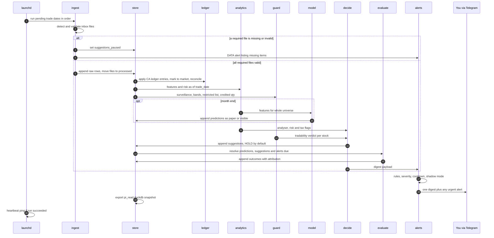
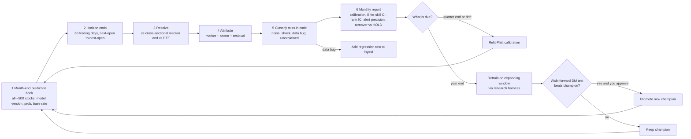
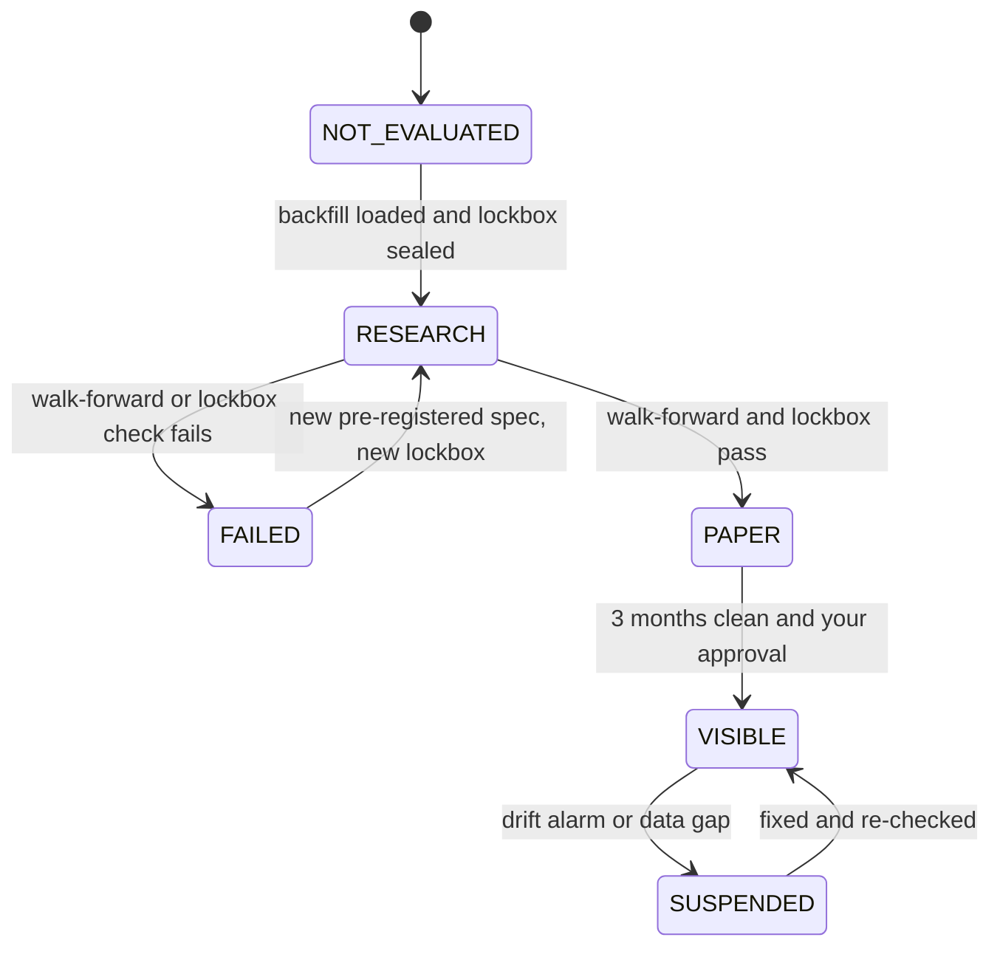

# Portfolio Intelligence: architecture v0.2

| | |
|---|---|
| **Status** | Proposed. Each ADR is accepted separately (see the [ADR index](#16-decision-index)). |
| **Date** | 2026-11-23 |
| **Replaces** | v0.1 (scratchpad draft). Also supersedes the F&O plan in [00-plan-review.md](00-plan-review.md). |
| **Evidence base** | [research/portfolio-intelligence-design-review.md](research/portfolio-intelligence-design-review.md) (verdicts R1–R9) and [research/architecture-v0.1-review.md](research/architecture-v0.1-review.md) (the review of v0.1 against SEBI rules, data correctness, test harness and predictive power) |
| **Requirements** | [requirements.md](requirements.md) |
| **Implementation** | [implementation-plan.md](implementation-plan.md) |
| **Update 2026-11-23** | A1, A6 and A8 answered: broker is Groww; the backfill is approved; you are not a designated person. See §2, §11.1 and §19. |

> Nothing in this document is legal or tax advice. Items marked **[unverified]** must be checked against the primary source, or with a CA, before you rely on them.

---

## 1. Purpose

A private, local tool for one person's NSE delivery portfolio (about ₹20k). Every evening it:

1. Loads that day's market, surveillance and holdings data.
2. Keeps an exact ledger of lots, costs and tax, with dated tax rules.
3. Analyses risk, concentration and performance against a buy-and-hold NIFTY 500 ETF, after costs and tax.
4. Checks what you can legally and practically trade. This covers your insider-trading restrictions (if any), exchange surveillance stage and shares not yet credited.
5. Sends filing, risk, tax and data alerts to you only.
6. **Once the model passes its go/no-go gate:** shows a calibrated probability for each stock and a suggestion. The suggestion defaults to HOLD.
7. Logs every prediction for the whole universe, resolves each one when its horizon ends, attributes the result, and improves the model on a fixed, statistically honest schedule.

**Non-goals:**
- No order placement and no stored broker keys.
- No automated collection from nseindia.com.
- No news used as a model feature.
- No "will go up/down" messages.
- No output shared with anyone else.

### What it can and cannot predict (the promise, stated honestly)

| Event | Predictable? | What the system offers |
|---|---|---|
| Tax and cost of an action | Exactly | Its strongest output |
| Scheduled events: results, ex-dates, the date a lot becomes long-term, trading-window closures | Yes (but results notice can be as short as 2 working days under LODR Reg 29) | Calendar alerts |
| Volatility over the next 20 days | Reasonably | Risk alerts |
| Size of the move on results day | Partly | A "usual move ±X%" range |
| Direction against peers over 60 days | Barely (AUC ≈ 0.52–0.56) | A ranking with a small lift, only after the gate |
| Direction on results day; unscheduled news; crash timing | No | An alert after the event, and scenario replays for exposure |

## 2. Assumptions (unconfirmed unless marked)

| # | Assumption | What changes if wrong |
|---|---|---|
| A1 | **Confirmed 2026-11-23:** the broker is **Groww**. Groww's holdings, order history, P&L report and contract notes are the inputs, cross-checked against the CDSL CAS statement. Which reports Groww exports, and in what format, is checked in WP 1.7. | Only `BrokerAdapter` changes |
| A2 | It runs on **one Mac**, which is often asleep | Alert latency (see §11.3) |
| A3 | Alerts go through **Telegram**, to you only | SMTP email is a drop-in replacement |
| A4 | **Python 3.12**, with `uv` and a lockfile | None |
| A5 | You download NSE files by hand: bhavcopy, the surveillance lists and the index files | Automated collection breaches NSE's terms |
| A6 | **Approved 2026-11-23:** a **one-month Kite Connect** subscription (₹500) for a one-off historical backfill. Kite Connect logs in with a Zerodha account, so this needs a free Zerodha account that is used only for data. Groww's own API was rejected because its historical data reportedly goes back only about 3 months. | Without it, Phase 3 waits for about 3 years of forward data |
| A7 | The universe is **NIFTY 500 members as of each date**, plus anything you hold. SME series (SM/ST) are excluded from the model. | Compute only |
| A8 | **Confirmed 2026-11-23:** you are not a designated person. `restricted.yaml` ships empty. `guard` keeps the rules, because Reg 4 (holding unpublished price-sensitive information) applies to anyone and your status can change. | If that changes, fill in `restricted.yaml` before the next trade |

## 3. Sizing

- **Market data:** about 2,500 equity rows a day × 250 trading days ≈ 0.6M rows a year, or about **20–40 MB a year** in Parquet. Ten years is under 0.5 GB.
- **Monthly prediction book:** 500 stocks × 12 months = 6,000 rows a year.
- **Model training:** about 60k rows, which takes LightGBM seconds.
- **Ledger, suggestions and alerts:** a few thousand rows a year.
- **What the design is most sensitive to:** missing data days and corporate-action errors. Volume is not a concern.

## 4. Context



## 5. Containers and modules

The system is a **modular monolith**: one Python package, an immutable Parquet raw layer, a DuckDB file written by one process, a read-only snapshot for the UI, and Streamlit plus a CLI. One user, one machine and about 40 MB of data a year don't justify services, queues or an orchestrator.



News and filings reach **only** `alerts`. Nothing connects news to `analytics` or `model` (ADR-0008).

### Module responsibilities

| Module | Owns | Must never |
|---|---|---|
| `ingest` | Detecting the format: legacy and UDiFF bhavcopy (UDiFF from 8 Jul 2024), delivery, index/TRI, surveillance lists, corporate-action files, broker CSVs. Validating schema, trading calendar and checksum. Sending bad files to `quarantine/` with a reason. | Fetch from nseindia.com; overwrite raw data |
| `refdata` | Internal `security_id`; the `isin_map` linking old and new ISINs; symbol history; series history (EQ/BE/BZ/SM/ST); the trading calendar | Use ISIN or symbol as a primary key |
| `store` | Bitemporal raw storage keyed by `ingest_seq`; `as_of(D)` views; corporate-action adjustment at read time using only actions with `ex_date ≤ D`; a snapshot export at the end of each run | Store adjusted prices as the truth |
| `ledger` | Trades; ledger entries created by corporate actions (bonus, split, demerger, rights entitlement, buyback, merger); FIFO lots per demat; the cost model, including DP charges; dated tax rules (§12); LTCG headroom shared with the ETF shadow; carry-forward losses | Guess missing trades; raise a reconciliation alert instead |
| `analytics` | Continuous trend; momentum, including distance from the 52-week high; EWMA and realised volatility; beta against NIFTY 500 and the sector; drawdown; shrunk correlation; risk contribution; active sector weight; scenario replays | Use chart-pattern or candlestick flags |
| `model` | Next-open 60-day labels against the cross-sectional median (§8); purged, embargoed, expanding walk-forward; LightGBM against a linear 3-factor baseline; Platt calibration; a **decile edge table** that converts probability into expected excess return | Read rows with `known_at > D`; read the lockbox |
| `research` | The **only** entry point to backtests (`pi.research.run_trial`). It writes a `trials` row before returning metrics, enforces the lockbox and checks the pre-registered gate spec (§14). | Return metrics without logging a trial |
| `guard` | Checks whether you can legally and practically trade: the restricted list (trading window, 6-month contra rule, pre-clearance); surveillance stage (ASM/GSM/ESM/T2T); price band and lower circuit; shares not yet credited; same-day sell warning; SME lot size | Be bypassed by `decide` |
| `decide` | Deterministic HOLD / REVIEW / TRIM / ADD / AVOID rules and template explanations | Produce an action that `guard` rejects, or one that fails the cost and tax hurdle |
| `evaluate` | Resolving predictions, suggestions and alerts; market/sector/residual attribution; miss classification in code; calibration; PSI drift; Diebold-Mariano promotion test | Retrain automatically; promote a model without your approval |
| `alerts` | Rules, severity, cooldown, shadow mode, the digest, urgent push and the filing poller | Send any prediction of direction |
| `ui` | Streamlit, reading **only** `pi_read.duckdb`. CLI commands: `pi run`, `pi status`, `pi reconcile`, `pi backfill`, `pi gate evaluate` | Open the writable database |

## 6. Directory layout

```
FNO/
  docs/                          # this file, requirements.md, adr/, research/
  pyproject.toml, uv.lock
  src/pi/{ingest,refdata,store,ledger,analytics,model,research,guard,decide,evaluate,alerts,ui}/
  tests/                         # golden parser files, FIFO/CA property tests, leakage tests, rule tests
  research/                      # notebooks; every backtest goes through pi.research
  config/
    rules.yaml                   # decision + alert thresholds (versioned)
    costs.yaml                   # broker/exchange/DP charges with effective dates
    tax.yaml                     # dated tax rules (§12)
    restricted.yaml              # insider-trading restricted list (§10.1)
    gate_spec.yaml               # pre-registered gate criteria; hash logged with every trial
  data/                          # NOT in git; Time Machine + encrypted off-machine copy
    inbox/  processed/YYYY/MM/  quarantine/
    raw/<source>/year=YYYY/      # immutable Parquet
    lockbox/                     # sealed most-recent ~2 years; research loader refuses it
    pi.duckdb                    # single writer: the evening job
    pi_read.duckdb               # snapshot for the UI, replaced atomically
```

## 7. Point-in-time data model

**Rules:**
- Every fact row carries `event_date` and `known_at`.
- Every query for date D filters on `known_at ≤ D`.
- Raw files are never updated. A re-issued exchange file is a new **version of the whole day** for that source, with a higher `ingest_seq`. Views take, per day, the latest version known as of D, so rows dropped from a correction disappear from it too. The first version's `known_at` follows the §8 convention. A correction's `known_at` is its real arrival time, and `ingested_at` always records the real arrival time. (Implemented in WP 1.3, 2026-11-23.)
- The primary key for a security is `security_id`, never ISIN or symbol.

| Table | Key | Main columns | Notes |
|---|---|---|---|
| `securities` | security_id | name, sector, listing_date, delisting_date | Internal ID, assigned once |
| `isin_map` | isin, valid_from | security_id, valid_to, reason (split / consolidation / demerger / merger) | A new ISIN maps to an existing or a new `security_id` |
| `symbol_history` | security_id, valid_from | symbol, valid_to | |
| `series_history` | security_id, valid_from | series (EQ/BE/BZ/SM/ST), valid_to | A move from EQ to BE is not a gap |
| `raw_bhavcopy` | trade_date, isin, series, ingest_seq | open, high, low, close, prev_close, volume, value, trades, source_file_sha, known_at, known_at_synthetic | Unadjusted prices |
| `raw_delivery` | trade_date, isin, ingest_seq | deliv_qty, deliv_pct, known_at | |
| `corp_actions` | security_id, ex_date, action_type | ratio, amount, record_date, new_security_id, cost_split_ratio, known_at | Covers split, bonus, dividend, rights entitlement, buyback, demerger, merger, capital reduction, delisting, suspension |
| `surveillance` | security_id, framework, effective_from | stage (ASM-LT / ASM-ST / GSM / ESM / T2T), effective_to, known_at | From the exchange lists you download |
| `price_bands` | security_id, effective_from | band_pct or "dynamic", known_at | |
| `index_levels` | index_name, trade_date | price_index, tri, known_at | |
| `index_membership` | index_name, security_id, effective_from | effective_to, known_at | Built from NSE circulars |
| `fundamentals_filed` | security_id, period_end, metric, filed_at | value, source_ref | `filed_at` is the timestamp of the exchange filing |
| `events_calendar` | security_id, event_type, event_date | source_ref, known_at | Board meetings, results, ex-dates |
| `trades` | trade_id | security_id, side, qty, price, trade_ts, contract_charges, demat, import_file_sha | |
| `ledger_entries` | entry_id | security_id, entry_type (trade / CA credit / CA debit / DP charge / dividend), qty, amount, effective_date, credit_date, source_ref | Corporate-action credits come from here |
| `lots` | lot_id | security_id, origin_entry_id, qty_open, cost_basis, acquired_date, ltcg_date | Derived by FIFO and fully rebuildable |
| `features` | asof_date, security_id, feature_set_ver | wide columns, close_regime flag | Parquet |
| `model_registry` | model_ver | trained_window, trial_id, status, calibration_params, decile_edge_table | |
| `trials` | trial_id | config_hash, gate_spec_hash, data_window, touched_lockbox, metrics, git_sha, created_at | Never deleted |
| `predictions` | asof_date, security_id, model_ver | prob, base_rate, decile, mode (paper / visible) | **The universe-wide monthly book.** All evaluation of the model happens here. |
| `suggestions` | suggestion_id | asof_date, security_id, model_ver or NULL, action, expected_edge_inr, hurdle_inr, guard_result, gate_reasons, payload_json, rules_ver, costs_ver, tax_ver, git_sha, data_snapshot_hash | Append-only; holdings and watchlist only |
| `user_actions` | action_id | suggestion_id, action_taken, note, recorded_at | Append-only. Kept separate so `suggestions` never changes. |
| `outcomes` | ref_type, ref_id | resolved_at, stock_ret, median_ret, etf_ret, market_part, sector_part, residual, label, miss_class | `ref_type` is one of prediction / suggestion / alert |
| `alerts` | alert_id | rule_id, rules_ver, severity, security_id, fired_at, mode (shadow / live), payload_json, delivered, acked_at | |
| `filing_items` | item_id | source, category, published_at, fetched_at, url, title, security_id | Used for alerts only. The text is untrusted. |
| `run_log` | run_id | trade_date, started_at, finished_at, status, steps_json | Drives `pi status` and the heartbeat |
| `system_state` | key | value, updated_at | gate_state, last_complete_trade_date, suggestions_paused |

## 8. Timing convention (no hidden look-ahead)

| Moment | Rule |
|---|---|
| Information time | Bhavcopy for day D is treated as known at **18:00 IST on D**. For backfilled rows, `known_at_synthetic = true`. |
| Decision time | The evening of D |
| Assumed execution | **The opening price of the next trading day (D+1).** It is used in backtests, paper P&L and labels. Slippage comes from `costs.yaml`. |
| Label | The total return (dividends included) from the D+1 open to the open 60 trading days later, compared with the cross-sectional median of the NIFTY 500 members as of D |
| Delisting during the horizon | Last traded price if the delisting was voluntary, −100% if forced. The `reason` column is recorded. |
| Closing Auction Session | NSE is introducing a closing auction for F&O stocks. Sources disagree on the live date (3 Aug 2026 or 7 Dec 2026) **[unverified]**. Features that use the close carry a `close_regime` flag. Labels use opens, which limits the impact. |
| Corporate-action adjustment | For date D, apply only actions with `ex_date ≤ D` |

## 9. Evening run

**Trigger:**
- `launchd` fires at 19:00 IST. If the Mac was asleep, the missed job runs once on wake. If it was powered off, `RunAtLoad` runs the job at your next login (ADR-0003).
- The run processes every pending `trade_date` in order and is idempotent per date.
- It is the only process that writes to `pi.duckdb`.



The **filing poller** is a separate `launchd` job. It runs every 2 hours from 08:00 to 22:00, and only against a source that has passed the terms check (ADR-0016).

## 10. Guard: can you trade this at all?

`guard` runs before `decide`, and its verdict overrides any action.

### 10.1 Insider-trading restrictions (SEBI PIT Regulations 2015)

This applies if you are a **designated person** at any listed company, or a relative of one. Configure it in `restricted.yaml`:

```yaml
# Example only. Empty for now (A8 confirmed 2026-11-23: not a designated person)
- security_id: <employer>
  basis: designated_person          # or: relative_of_dp, holds_upsi
  window: quarter_end_to_results_plus_48h
  contra_trade_months: 6            # minimum; your company code may be longer
  preclearance_threshold_inr: <from company code>
```

Effects:
- TRIM and ADD are blocked while the trading window is closed.
- An action opposite to a trade made within the contra period is blocked.
- An action above the pre-clearance threshold shows "needs pre-clearance".
- Reg 4 bans trading **any** stock while you hold its unpublished price-sensitive information, so `holds_upsi` can be added for any security.
- The system cannot detect your insider status. You are responsible for keeping this list correct.

Since Apr 2025 the automated PAN freeze also covers designated persons' immediate relatives. Source: [SEBI circular, Apr 2025](https://www.sebi.gov.in/legal/circulars/apr-2025/trading-window-closure-period-under-clause-4-of-schedule-b-read-with-regulation-9-of-securities-and-exchange-board-of-india-prohibition-of-insider-trading-regulations-2015-pit-regulations-ext-_93504.html).

### 10.2 Exchange surveillance and tradability

| Condition | Source | Guard effect | Alert |
|---|---|---|---|
| Moves into ASM, GSM or ESM, or changes stage | Exchange lists (downloaded by hand) | Hides ADD from GSM stage 2. Under weekly-only trading (GSM stage 3 and up), shows the next trading day. | 🔴 |
| Series changes from EQ to BE or BZ (trade-for-trade) | Bhavcopy series | No intraday or same-day reversal; delivery only | 🔴 |
| Price band cut, or stock locked at the lower circuit | Price bands + bhavcopy | TRIM marked "may not fill" | 🟡 |
| Corporate-action shares not yet credited | `ledger_entries.credit_date` | TRIM is limited to credited quantity | 🟡 |
| Same-day buy and sell | Trades | Warning: taxed as speculative income | 🟡 |
| SME series (fixed lot size) | Series | Minimum sell = 1 lot | — |

Surveillance stage details, especially the mid-stage ASM margins, are partly **[unverified]**. Store the stage name; keep its rules in `rules.yaml`.

## 11. Decide and alerts

### 11.1 Decision rules

| Action | Fires when | Hard limits |
|---|---|---|
| **HOLD** | Default | — |
| **REVIEW** | A thesis-break flag: a large factor-score change, a critical filing, a drawdown limit, entry into surveillance, a data anomaly, or a risk-share rule (calibrated in Phase 2) | Asks for attention only |
| **TRIM** | All four must hold: `gate_state = VISIBLE`; guard passes; `expected_edge_inr > hurdle_inr`; no lot is within 60 days of becoming long-term (unless it is the loss case) | Minimum sell ₹5,000, or the whole holding if smaller; at most one TRIM per quarter; 30-day cooldown per stock. At ₹20k a TRIM is usually a whole-holding sale (ADR-0006). |
| **ADD** | The same edge test, preferably funded by fresh cash | Within the concentration limit; guard passes |
| **AVOID** | Watchlist names only | Never shown on a stock you hold |

**`expected_edge_inr`** is built from the model's **decile edge table**:
1. From the walk-forward test, take each probability decile's mean realised excess return against the beta-adjusted ETF over 60 days.
2. Shrink it by `edge_shrinkage` (default 0.5).
3. Multiply by the position value.

**`hurdle_inr`** is the sum of:
- sell-side STT, exchange and SEBI fees, GST and stamp duty;
- Groww's delivery brokerage on both legs: ₹20 or 0.1% per order, whichever is lower, with a ₹5 minimum;
- the **DP charge** (Groww: ₹20 + GST ≈ ₹23.60 per stock per sell day);
- the cost of buying the replacement (the ETF);
- incremental tax: STCG at **20% + 4% cess**, with no 87A rebate on STCG under the new regime, or LTCG at **12.5% + cess** above the remaining shared ₹1.25L headroom.

The Groww figures come from Groww's pricing page and third-party summaries as of 2026-11-23. WP 1.9 confirms them again and stores them with dates in `costs.yaml`.

On a ₹2,500 sell, the sell-side costs (DP charge, ₹5 minimum brokerage, STT and GST) come to about 1.3%. At ₹5,000 they are about 0.7%, which is why the minimum sell is ₹5,000.

A cap of 10% monthly turnover (₹2,000 at ₹20k) could never be met alongside that minimum, so overtrading is limited by a cap on the number of trades instead: at most one TRIM per quarter.

The TRIM screen shows the tax and cost consequence, **not** the purchase price or unrealised P&L. Showing those encourages the disposition effect: selling winners too early and holding losers too long.

### 11.2 Alert rules

**New 🟡 rules start in shadow mode for 20 trading days.** In shadow mode they are logged but not sent, so thresholds can be set from how often they actually fire.

| Rule | Severity | Trigger | Source |
|---|---|---|---|
| Data missing or invalid | 🔴 | A required file is absent, or validation fails | ingest |
| Holdings don't reconcile | 🔴 | Ledger ≠ broker after applying CA entries | ledger |
| Critical company filing | 🔴 | Auditor resignation, default, fraud disclosure, or regulatory action (LODR Reg 30) | Filing feed |
| Promoter pledge increase | 🔴 | A new encumbrance disclosure (SAST Reg 31) | Pledge disclosures (separate exchange page) |
| Surveillance entry or change | 🔴 | ASM, GSM, ESM, T2T | Exchange lists + series |
| Restricted-window open or close | 🔴 | Trading window changes for a restricted stock | `restricted.yaml` + events calendar |
| Drawdown | 🔴 | Down ≥ 15% from the peak since purchase **and** ≥ 8% behind NIFTY 500 | analytics |
| Results ahead | 🟡 | A board-meeting notice for results has been filed. Reg 29 requires as little as 2 working days' notice, so this is event-driven, not a fixed number of days. | Filing feed |
| Risk shift | 🟡 shadow | 20-day EWMA volatility ≥ 2× its 1-year median; the risk-share rule is calibrated in Phase 2 | analytics |
| Tax window | 🟡 | A lot becomes long-term within 30 days; ≥ 80% of LTCG headroom used | ledger |
| Corporate action | 🟡 | An ex-date within 5 days; shares pending credit | `corp_actions` |
| Model shift | 🟡 (VISIBLE only) | The stock moves between the top and bottom quintile | model |
| Model health | 🟡 | Calibration slope or PSI drift | evaluate |

**Invariants:**
- No alert ever predicts direction.
- Alerts go to you only.
- Telegram messages carry **only the ticker, rule and severity**, with no amounts or holdings. Details stay in the local UI, because Telegram bot chats are not end-to-end encrypted.
- More than 3 urgent pushes in a week triggers a threshold review.

### 11.3 Alert latency

Urgent alerts arrive only **while the Mac is awake**. A filing at 11:00 on a day the laptop is closed reaches you when it next wakes, and the price has usually moved within minutes anyway. If you need lower latency, the option is to run only the filing poller on a free scheduled cloud job. It would know your watchlist as a list of IDs and nothing else. This is deferred.

### 11.4 Alerts are scored too

Each alert with a `security_id` is resolved at 20 and 60 days, using excess return against the ETF. The monthly report shows each rule's precision. A rule with no measurable value gets demoted or removed.

## 12. Tax engine (dated rules in `tax.yaml`)

| Rule | Treatment | Effective | Confidence |
|---|---|---|---|
| STCG (listed equity, held ≤ 12 months) | 15% → **20%** | 20%: sales on or after 23 Jul 2024 | Verified |
| LTCG | 10% → **12.5%**; exemption ₹1L → **₹1.25L** per person per year, shared by all equity sales including the ETF | 23 Jul 2024 | Verified |
| 87A rebate against STCG under the new regime | Not available | FY 2025-26 (FY 2026-27 likely the same) | Partly verified |
| Buyback, shareholder side | Capital gains before 1 Oct 2024. Deemed dividend with the cost as a capital loss from 1 Oct 2024 to 31 Mar 2026. **Capital gains again from 1 Apr 2026** (Finance Act 2026), with an extra charge for promoters. | 3 periods | Secondary sources |
| Bonus shares | Cost nil; holding period from the allotment date | — | Verified |
| Demerger | Cost split by the ratio the company announces; holding period includes the original shares | — | Verified |
| Lot order | FIFO per demat account | — | Verified |
| Loss set-off | Short-term losses offset STCG or LTCG; long-term losses offset only LTCG; carry forward **8 years [unverified]** | — | Partly |
| Same-day buy and sell in delivery | Speculative business income | — | Verified (secondary) |
| Dividend stripping, s.94(7) | Loss disallowed up to the dividend when bought ≤ 3 months before the record date and sold ≤ 3 months after **[unverified windows]** | — | Partly |
| Dividend TDS threshold | ₹10,000 a year per company | FY 2025-26 | Verified |
| Section numbers under the Income-tax Act 2025 | Stored as labels only, for example STCG s.196 and LTCG s.198 **[unverified]** | 1 Apr 2026 | Unverified |

Review this table with a CA once a year.

## 13. The learning loop



- **Evaluation unit:** the monthly universe-wide book has about 500 predictions per month. Each prediction resolves over 60 trading days, so consecutive books overlap by about two months; standard errors use HAC or a month-block bootstrap (ADR-0015). Your 4–6 holdings are far too few to measure anything.
- **Miss classes, decided in code:**
  - *noise:* |residual| < 1.5 × the stock's idiosyncratic volatility over the horizon;
  - *shock:* market plus sector explain most of the move;
  - *data bug:* a validation flag was set on an input date;
  - *unexplained:* everything else.
- **No learning from a single trade.** A well-calibrated 60% call is wrong 40% of the time.
- **Optional, later (R9):** an LLM evidence-finder for *unexplained* cases. Outcome-blind (it lists cited, dated events before seeing the return), anonymised, allowed to answer "insufficient evidence". It writes notes for you and never touches the model.

## 14. Go/no-go gate and research harness



### 14.1 Gate criteria

The criteria are pre-registered in `gate_spec.yaml`, and the file's hash is logged with every trial. All of them must pass.

1. **Walk-forward (pre-lockbox), purged and embargoed:**
   - the lower bound of the 95% Brier-skill CI, from a bootstrap that resamples whole months, is above 0;
   - AUC is significantly above 0.5 **and** below the 0.57 leakage alarm;
   - the top-minus-bottom decile spread is above 0 after `costs.yaml`.
2. **Deflated Sharpe and PBO** are reported, using the trial count in `trials`.
3. **Lockbox**, evaluated **once**, by you, with `pi gate evaluate --lockbox`: Brier skill above 0 and a positive top-minus-bottom spread.
4. **Caveat:** the backfill is survivorship-biased, so passing is necessary but not sufficient. The PAPER period is the final check.

`FAILED` is a valid ending. The system remains a ledger, analyser, guard and alert tool, and holding the ETF is then the evidence-backed choice.

### 14.2 Controls on coding agents and research

When any AI agent, including Claude Code, iterates on features or parameters, it is automated data snooping. Controls:

- `pi.research.run_trial()` is the **only** backtest entry point. It logs the trial (config hash, git SHA, data window) **before** returning metrics.
- The research data loader refuses any date inside `data/lockbox/`. A test fails the build if any code path under `research/` or `src/pi/model` reads the lockbox.
- Once the lockbox has been evaluated it is **burned** (marked in `trials`). The next lockbox must be new forward data.
- Agents may propose ideas, write code and run trials. They may not:
  - edit `gate_spec.yaml` after its hash is logged;
  - delete trials;
  - run `pi gate evaluate`.
- Any LLM used at runtime (filing triage, explanations) must:
  - return structured output against a fixed category list;
  - run with no tools and no memory;
  - use a pinned model version;
  - pass regression tests on a golden set of about 100 labelled filings;
  - treat input text as data only.

## 15. Testing and operations

| Area | Check |
|---|---|
| Parsers | Golden files per format, including the UDiFF changeover and ISIN changes after a split |
| Ledger | Property tests: lots sum to holdings after every kind of CA. Contract-note match within ₹1, **excluding the DP charge**, which is on the ledger and not the contract note. Tax P&L matches the broker report. |
| Leakage | Perturbing future rows leaves predictions for D unchanged; no query for D sees `known_at > D`; the lockbox-access test |
| Model | Out-of-sample AUC > 0.57 fails the build |
| Guard and rules | Unit tests per rule: window closure, contra period, surveillance stages, uncredited quantity |
| Reproducibility | Every suggestion stores git SHA, versions of rules, costs and tax, feature-set version and data-snapshot hash. `pi replay <suggestion_id>` must reproduce it. |
| Concurrency | The evening job is the only writer. The UI reads only `pi_read.duckdb`, which is replaced atomically. DuckDB allows one writing process **or** several read-only processes, not both, hence the snapshot. |
| Liveness | `run_log` + `pi status`. A heartbeat ping goes out on success; a missed ping triggers an email from the external monitor. The ping carries no data. |
| Secrets | The Telegram token is in macOS Keychain, readable by the LaunchAgent only while you are logged in. No secrets in the repo. |
| Backup | `data/` is backed up to Time Machine plus an encrypted off-machine copy. The raw archive can't be rebuilt. |
| Network | Streamlit binds to `localhost` only |

## 16. Decision index

| ADR | Title | Status |
|---|---|---|
| [0001](adr/0001-modular-monolith.md) | Modular monolith in one package | Proposed |
| [0002](adr/0002-parquet-duckdb-bitemporal.md) | Bitemporal Parquet raw layer + DuckDB | Proposed |
| [0003](adr/0003-launchd-idempotent-runs.md) | launchd with catch-up and idempotent runs | Proposed |
| [0004](adr/0004-manual-inbox-ingestion.md) | Manual inbox ingestion | Proposed |
| [0005](adr/0005-no-automated-execution.md) | No automated execution, no broker keys | Proposed |
| [0006](adr/0006-hold-default-decision-gate.md) | HOLD-default decision rules with a cost and tax hurdle | Proposed |
| [0007](adr/0007-model-behind-gate.md) | Model hidden behind the go/no-go state | Proposed |
| [0008](adr/0008-news-alerts-only.md) | News and filings for alerts only | Proposed |
| [0009](adr/0009-template-explanations.md) | Template explanations; LLM off by default | Proposed |
| [0010](adr/0010-retrain-and-promotion.md) | Annual retrain, quarterly recalibration, Diebold-Mariano promotion | Proposed |
| [0011](adr/0011-internal-security-id.md) | Internal security_id and ISIN map | Proposed |
| [0012](adr/0012-guard-compliance-tradability.md) | Guard module: insider-trading and surveillance tradability | Proposed |
| [0013](adr/0013-next-open-execution-convention.md) | Next-open execution and label convention | Proposed |
| [0014](adr/0014-research-harness-lockbox.md) | Research harness: trial wrapper + lockbox | Proposed |
| [0015](adr/0015-universe-prediction-book.md) | Universe-wide monthly prediction book | Proposed |
| [0016](adr/0016-alert-sources-terms.md) | Alert sources must pass a terms check; no NSE RSS polling | Proposed |
| [0017](adr/0017-ui-read-snapshot.md) | UI reads a snapshot; single writer | Proposed |

## 17. Build phases and exit criteria

| Phase | Builds | Exit criteria (all must hold) |
|---|---|---|
| **0. Skeleton** | Repo, `uv`, pinned dependencies, test harness, `config/*.yaml`, CLI stub | `pi status` runs; tests pass |
| **1. Data, refdata, ledger and guard** (R1, R2) | Parsers; `security_id` and ISIN map; bitemporal store; CA ledger entries; FIFO; costs; dated tax; ETF shadow; `restricted.yaml`; surveillance ingest | 60 consecutive trading days with no unresolved quarantine. Ledger matches the broker exactly. Contract notes match within ₹1, excluding DP. Tax P&L matches the broker report. **A8 confirmed** (restricted list filled in or confirmed empty). |
| **2. Analyser and alerts** (R3) | Risk, concentration, scenarios; alert rules (🟡 in shadow); digest; heartbeat; filing source chosen under ADR-0016 | 20 days of digests delivered. Shadow rules calibrated. ≤ 3 urgent alerts a week. |
| **3. Research** (R4, R5) | Feature store, labels (§8), harness and lockbox, walk-forward, LightGBM against the baseline, calibration, decile edge table | Gate verdict recorded. **FAILED is a valid ending.** |
| **4. Paper decisions** (R6, R8) | Monthly universe book, decide, user actions, resolve and attribute, monthly report | 3 months with no pipeline bugs, then your approval → VISIBLE |
| **5. Explanations** (R7) | Templates; optional LLM behind a validator | Validator passes 100% of 200 explanations |
| **6. Optional** (R9) | Outcome-blind LLM evidence-finder | After one year of ledger history |

For the work packages, their order and the user-supplied files, see [implementation-plan.md](implementation-plan.md). The plan builds two things earlier than this table shows: a thin daily ingest slice, so the 60-day count starts sooner, and the coding-agent controls, which move into Phase 0.

## 18. Top risks

| Risk | Likelihood | Impact | Mitigation | How you'd notice |
|---|---|---|---|---|
| Trading during an insider-trading window or contra period | Low (A8: not a designated person) | **Very high** (SEBI action) | `guard` + `restricted.yaml`; A8 is an exit criterion for Phase 1 | Guard blocks the action; red alert |
| Look-ahead leakage or snooping inflates the backtest | Medium | Very high | §8 convention, perturb-future tests, lockbox, trial wrapper | Build fails / lockbox fails |
| Wrong CA adjustment or ISIN break creates fake moves or broken lots | Medium | High | `security_id`, ISIN map, CA ledger entries, jump checks | Reconciliation alert |
| Suggested action can't be executed (surveillance, lower circuit) | Medium | Medium | `guard` tradability checks | Action hidden; surveillance alert |
| A trading day is missing | High | Medium | Pause plus red DATA alert | Alert |
| NSE file format changes | Medium | High | Format detection, quarantine, golden tests | Quarantine alert |
| Survivorship bias in the backfill | Certain | Medium | Treat as an upper bound; PAPER phase | Gate report |
| Alert fatigue drives overtrading | Medium | High | Shadow mode, weekly cap, alert scoring, HOLD default | Monthly report |
| Job silently not running | Medium | Medium | Heartbeat monitor | Email |
| Tax rules change | Medium | Medium | Dated `tax.yaml`; annual CA review | Annual review |
| Filing feed breaches terms | Medium | Medium | ADR-0016 terms check; manual fallback | — |
| Sharing outputs drifts into SEBI RA/IA scope | Low | Very high | Single recipient; no public performance claims | — |

## 19. Open questions

1. ~~**A8:** Are you, or any relative, a designated person?~~ **Resolved 2026-11-23:** no.
2. ~~**A1:** Which broker do you use?~~ **Resolved 2026-11-23:** Groww.
3. ~~**A6:** Pay ₹500 once for the Kite backfill?~~ **Resolved 2026-11-23:** yes. This needs a free Zerodha account used only for data.
4. Which filing source passes the terms check: BSE RSS, broker alerts, or manual? (ADR-0016)
5. Does NSE publish the surveillance lists as downloadable files, and in what format? **[unverified]**
6. Which Closing Auction Session date is live: 3 Aug 2026 or 7 Dec 2026? **[unverified]**
7. Watchlist names; default thresholds (−15% drawdown, ₹5,000 minimum sell, one TRIM per quarter).

## 20. Changelog: v0.1 → v0.2

| # | Fix | Where |
|---|---|---|
| 1 | Insider-trading restricted list and guard | §10.1, ADR-0012 |
| 2 | Next-open execution and label convention | §8, ADR-0013 |
| 3 | Internal `security_id` + ISIN map (ISIN is not stable) | §7, ADR-0011 |
| 4 | Surveillance tradability (ASM/GSM/ESM/T2T, bands, circuits) | §10.2, ADR-0012 |
| 5 | NSE RSS polling dropped; sources must pass a terms check | ADR-0016 |
| 6 | Dated buyback tax rules (3 periods) and the rest of the tax table | §12 |
| 7 | CA ledger entries, credit dates, TRIM limited to credited quantity | §7, §10.2 |
| 8 | Decile edge table, so expected edge is in rupees | §11.1 |
| 9 | Universe-wide monthly prediction book | §13, ADR-0015 |
| 10 | Stronger, pre-registered gate with CI lower bound and lockbox | §14.1 |
| 11 | Research harness: trial wrapper, lockbox, agent limits | §14.2, ADR-0014 |
| 12 | Single writer; UI reads a snapshot | §15, ADR-0017 |
| — | Smaller fixes: bitemporal raw corrections; separate `user_actions`; total-return labels with delisting rule; series history; Reg 29 event-driven results alert; pledges from SAST source; Closing Auction flag; 87A/STCG in hurdle; shared LTCG headroom; DP excluded from contract-note match; static-IP reasoning corrected (ADR-0005); heartbeat; minimal Telegram content; shadow-mode alerts; alert scoring | Various |
